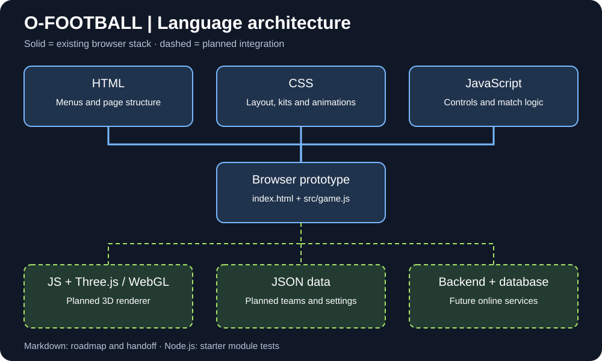

# O-FOOTBALL

Browser football prototype. Start with `python -m http.server 8000` from the repository root and open http://localhost:8000.

- [Roadmap](docs/DEVELOPMENT_PLAN.md)
- [Current stage](docs/STATUS.md)
- [Developer handoff](docs/HANDOFF.md)
- [Testing](docs/TESTING.md)
- [AI instructions](AGENTS.md)

Existing game: `index.html` and `src/game.js`. New starter modules: `src/systems/`. Other folders are planned subsystem boundaries, not finished implementations.
